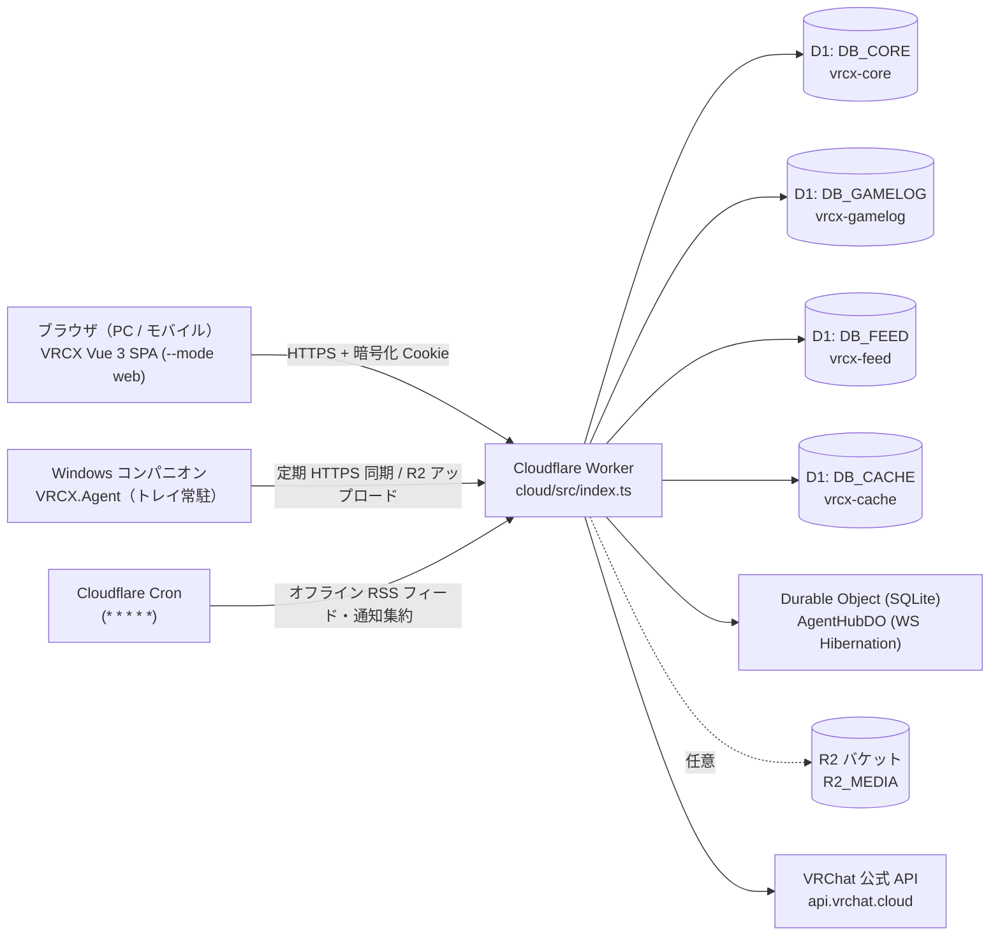

<div align="center">

#  VRCX-Worker

**Cloudflare Workers（無料プラン）で動作する完全ステートレス・クラウドホスト版 VRCX**

*オリジナル [vrcx-team/VRCX](https://github.com/vrcx-team/VRCX)（MIT ライセンス）からの派生プロジェクト*

[English](./README.md) | [简体中文](./README.zh-CN.md) | **日本語**

[](https://deploy.workers.cloudflare.com/?url=https://github.com/nuomew/VRCX-Worker)
[](https://github.com/nuomew/VRCX-Worker/releases/latest)
[](https://github.com/nuomew/VRCX-Worker)
[](./LICENSE)

</div>

---

## プロジェクト概要

**VRCX-Worker** は [vrcx-team/VRCX](https://github.com/vrcx-team/VRCX)（ベースライン `2026.11.14`）をベースに、**Cloudflare Workers の無料プラン（Free Tier）** で個人向けに 24 時間運用できるよう再設計したクラウド版 VRCX です。オリジナルの Vue 3 UI を完全ステートレスな Web アプリとして提供し、**Cloudflare Workers + 4 シャード D1 + SQLite Durable Object（WebSocket Hibernation）+ 任意の R2 プライベートストレージ**、および任意の軽量 Windows 常駐コンパニオン（[`VRCX-Agent/`](./VRCX-Agent/)）と連携します。

- **100% ステートレスなブラウザ設計（ローカル保存不要）**：ブラウザの OPFS や IndexedDB をプライマリ DB として使用しません。キャッシュ削除・シークレットウィンドウ・PC／スマートフォン間の切り替えを行っても、設定・メモ・お気に入り・フレンド履歴・ゲームログ・通知・暗号化保存された VRChat セッションをすべて Cloudflare D1 から復元できます。
- **24 時間クラウド RSS 定期集約 & 4 シャード D1**：毎分起動する Cloudflare Cron（`* * * * *`）が Web 側で設定した同期インターバル（既定 `300秒` / 5 分）に従い、ブラウザを閉じていてもフレンドのオンライン／オフライン／GPS／ステータス／プロフィール変更・Friend Log・v1/v2 通知を自動記録します。同時に専用キャッシュシャード `DB_CACHE`（`vrcx-cache`）を予熱し、ブラウザから `api.vrchat.cloud` への過剰リクエストを防ぎます。
- **軽量 Windows トレイコンパニオン（[`VRCX-Agent/`](./VRCX-Agent/)、CEF / Electron 不使用）**：
  - Windows タスクトレイに静かに常駐する軽量 .NET 10 アプリ。標準インストーラー版（.NET 10 ランタイム同梱・UAC 不要のユーザー単位 `%LocalAppData%\Programs\VRCX.Agent` インストール・自動起動対応）、スタンドアロン ZIP 版、約 1.5 MB の軽量ポータブル版を用意しています。
  - OS 言語に応じた日本語環境での英語／簡体字中国語自動切替に加え、**GitHub Releases からの SHA-256 検証付きオンライン自動アップデート**を内蔵しています。
  - **クラウド URL と同期シークレット**だけで簡単に接続でき、Web 側で指定した間隔（既定 `60秒`、`30〜3600秒`）に従って HTTPS `POST /api/agent/sync` で定期送信します。オフライン JSONL キュー、差分 `output_log_*.txt` オフセット管理、過去ログの自動バックフィルに対応しています。
  - **ダイレクト接続 / プロキシ経由**のワンクリック切替を内蔵し、Windows システムプロキシ、HTTP/HTTPS/SOCKS4/SOCKS5、さらにネイティブ **VMess AEAD（`vmess://`）**（TCP / TCP+HTTP 偽装 / TLS / WS / WSS）をサポートします。
  - 現在のインスタンス内プレイヤー一覧スナップショット、VRChat / SteamVR の正確な OS プロセス起動時刻、ローカル PNG メタデータ埋め込み（`desktop/Dotnet/ScreenshotMetadata/`）、任意の R2 クラウドギャラリーへの写真アップロード（オリジナル PNG または ≤1600px WebP 圧縮）、Discord Rich Presence、AutoAppLaunch、XSOverlay / OVRToolkit VR 通知、6 種類の許可リスト制リモートコマンドに対応します。
- **リポジトリの明確な分離とデスクトップ版ゼロリグレッション**：オリジナルのデスクトップ版専用コード（Windows CEF、Linux/macOS Electron、NSIS インストーラー、デスクトップ用ビルドスクリプト）はすべて [`desktop/`](./desktop/) 配下へ分離し、二次開発の本体（`wrangler.jsonc`、`cloud/`、`VRCX-Agent/`、`src/` Web アダプタ、`docs/`）をリポジトリルートに配置しています。Cloudflare の自動デプロイには一切影響しません。

---

## システムアーキテクチャ



### Cloudflare 無料プラン向け設計ポイント

| コンポーネント | バインディング / リソース | 役割と無料枠保護の仕組み |
|---|---|---|
| **静的アセット** | `./build/web` | ビルド済み Vue SPA を Cloudflare エッジから直接配信し Worker 実行回数を節約（`run_worker_first` は `/health`・`/poc/*`・`/api/*`・`/ws/*` のみ Worker へルーティング） |
| **コア DB シャード** | `DB_CORE`（`vrcx-core`） | 設定バンドル、統計カウンター、`entity_users`/`entity_worlds` FTS5（`trigram`）検索辞書、メモ、お気に入り、アバタータグ、Friend Log、通知、デバイス・コマンド管理、AES-256-GCM 暗号化 Cookie ボールト |
| **ゲームログシャード** | `DB_GAMELOG`（`vrcx-gamelog`） | ワールド移動、プレイヤー参加／退出、ポータル、動画再生、イベント・外部ログ。B-Tree インデックスと `UNIQUE` 重複排除により単一 DB 500 MB 上限を回避 |
| **フィードシャード** | `DB_FEED`（`vrcx-feed`） | `feed_gps`、`feed_online_offline`、`feed_status`、`feed_bio`、`activity_sessions_v2` |
| **キャッシュシャード** | `DB_CACHE`（`vrcx-cache`） | サーバー側階層キャッシュ（`vrc_api_cache`）と RSS スナップショットを保持し、`api.vrchat.cloud` への重複アクセスを削減 |
| **Durable Object** | `AGENT_HUB`（`AgentHubDO`） | SQLite ベースの WebSocket Hibernation（`ctx.acceptWebSocket` + 自動 `ping`/`pong`）を採用し、アイドル接続の課金・実行時間をゼロに抑制 |
| **オブジェクトストレージ** | `R2_MEDIA` *(任意)* | クラウドギャラリー用のプライベート R2 バケット（オリジナル PNG または ≤1600px WebP サムネイル保存、無料枠 10 GB/月・転送量無料） |

---

## クイックスタート：Cloudflare Workers ワンクリックデプロイ

> 詳しいデプロイ手順、セキュリティシークレット、R2 ギャラリー設定、Windows コンパニオン連携手順は以下のガイドをご参照ください：
> - **日本語**：[`docs/cloud-architecture/DEPLOY.ja.md`](./docs/cloud-architecture/DEPLOY.ja.md)
> - **English**：[`docs/cloud-architecture/DEPLOY.md`](./docs/cloud-architecture/DEPLOY.md)
> - **简体中文**：[`docs/cloud-architecture/DEPLOY.zh-CN.md`](./docs/cloud-architecture/DEPLOY.zh-CN.md)

1. 上部の **Deploy to Cloudflare** ボタンをクリックするか、**Cloudflare ダッシュボード → Workers & Pages → 作成 → リポジトリをインポート** から **`nuomew/VRCX-Worker`** を選択します。
2. ルートディレクトリ（`.`）および既定のデプロイコマンド `npx wrangler deploy` をそのまま維持します：
   - ルートの [`wrangler.jsonc`](./wrangler.jsonc) に `"build": { "command": "npm run build:web" }` が定義されているため、ダッシュボードの **ビルドコマンド** を空欄のままにしても `./build/web` へ自動ビルドされます。
   - Cloudflare Automatic Resource Provisioning により 4 つの D1 シャード（`vrcx-core`、`vrcx-gamelog`、`vrcx-feed`、`vrcx-cache`）と `AgentHubDO` が自動的に作成・紐付けされます（`R2_MEDIA` は R2 未契約環境でもエラーにならないよう既定オフです。クラウドギャラリー利用時はダッシュボードで手動バインドするか、`wrangler.jsonc` の `r2_buckets` をコメント解除してバケット名を指定してください）。
   - 初回 HTTP リクエスト時に [`cloud/src/db/schemaBootstrap.ts`](./cloud/src/db/schemaBootstrap.ts) が全テーブル・インデックス・FTS5 辞書を冪等に自動初期化します。
3. **推奨セキュリティ設定**：通常利用を開始する前に、**Worker → 設定 → 変数とシークレット（Variables and Secrets）** にて `ADMIN_PASSCODE`（パスコード保護）、任意の `ADMIN_TOTP_SECRET`（二要素認証）、`COOKIE_MASTER_KEY`（32 文字以上の暗号化マスターキー）、または Cloudflare Access（`CF_ACCESS_TEAM_DOMAIN` + `CF_ACCESS_AUD`）を設定してください。
4. *(任意)* [GitHub Releases](https://github.com/nuomew/VRCX-Worker/releases/latest) から **`VRCX.Agent-v*-Setup-win-x64.exe`** をダウンロードしてインストールし、Web UI 下部ステータスバーの **Cloud → Win Agent (HTTP Sync)** で同期シークレットを作成して `VRCX.Agent` に入力し、**Test & Save** をクリックします。

---

## 機能一覧

| 機能カテゴリ | クラウド Web UI（`--mode web`） | Windows コンパニオン（`VRCX.Agent`） |
|---|---|---|
| フレンド・ワールド・アバター・グループ・お気に入り・メモ・統計チャート | 標準対応（D1 ステートレス保存） | — |
| 24 時間オフライン Feed・Friend Log・通知記録 | 標準対応（Cloudflare Cron RSS 集約） | — |
| VRChat ローカル `output_log_*.txt` 差分収集 & 過去ログ補完 | GameLog・インスタンス履歴・アクティビティ表示 | バイトオフセット管理 + オフライン JSONL キュー |
| 現在のインスタンス内プレイヤー一覧 & 正確な稼働時間 | リアルタイム表示（再読み込みでもリセットなし） | OS プロセス起動時刻と在室プレイヤーを収集 |
| クラウド写真ギャラリー（PNG メタデータ & 任意 R2 WebP） | 日付別表示・原寸ダウンロード | VRCX PNG メタデータ書き込み & プライベート R2 送信 |
| Discord Rich Presence・AutoAppLaunch・XSOverlay / OVRToolkit | Web 画面からリモート指示 | Windows ローカルで安全実行（6 種類の許可リスト制） |
| ダイレクト接続 / プロキシ・ネイティブ `vmess://` 対応 | Cloudflare エッジ経由でアクセス | トレイ／設定からワンクリック切替（HTTP/SOCKS/VMess） |

---

## リポジトリ構成

```text
VRCX-Worker/
├── wrangler.jsonc              # ルート Cloudflare Workers 自動デプロイ設定（Worker + Assets + 4 D1 + DO + R2 + Cron）
├── package.json                # ルート Vite/Vitest スクリプト（wrangler が npm run build:web を自動実行）
├── src/                        # 共有 Vue 3 フロントエンド + WEB モードアダプタ：
│   ├── ipc-web/                #   ブラウザ向けネイティブブリッジ代替（WebApi、AppApi、起動キャッシュ、RSS 同期）
│   ├── services/database/cloud/#   Worker API 経由の構造化クラウドリポジトリ（生 SQL 非公開）
│   └── components/cloud/       #   クラウドロック画面、Cloud Hub、デバイス・同期キー管理 UI
├── cloud/                      # Cloudflare Worker TypeScript バックエンド
│   ├── src/                    #   auth/、cache/、crypto/、db/、hub/AgentHubDO.ts、routes/、search/、sync/
│   ├── migrations/             #   core・gamelog・feed・cache 各 D1 シャード用 SQL DDL
│   └── test/                   #   Miniflare / workerd 自動 Vitest テストスイート
├── VRCX-Agent/                 # 軽量 .NET 10 Windows トレイコンパニオン（Core/、Platform/、Installer/）
├── VRCX-Agent.Tests/           # クロスプラットフォーム xUnit テストスイート
├── docs/cloud-architecture/    # 多言語デプロイガイド（DEPLOY*.md）および技術仕様書（Tech-Spec.md）
├── desktop/                    # 分離されたオリジナル デスクトップ版 VRCX（ゼロリグレッション維持）：
│   ├── Dotnet/                 #   Windows CEF、Linux/macOS Electron .NET バックエンド、DBMerger、共有 Discord/PNG モジュール
│   ├── src-electron/           #   Electron メインプロセス、preload、Linux OpenVR ライブラリ
│   ├── Installer/              #   Windows NSIS デスクトップインストーラー一式
│   ├── build-scripts/          #   デスクトップ用ビルド・ライセンス生成・パッケージスクリプト
│   ├── VRCX.slnx               #   デスクトップ版 .NET ソリューション
│   ├── electron-builder.config.js
│   └── README/                 #   オリジナル デスクトップ版の多言語 README 群
├── images/                     # Web・Agent・デスクトップ共通アイコン
├── README.md                   # 英語ドキュメント
├── README.zh-CN.md             # 簡体字中国語ドキュメント
├── README.ja.md                # 日本語ドキュメント（本ファイル）
└── MEMORY.md                   # 設計判断・監査修正履歴・運用メモ
```

---

## ローカル開発と検証

### 必要環境
- **Node.js** `>= 24.15.0`（ローカルが Node 22 の場合は `--engine-strict=false` を付与）および **npm**
- **.NET 10 SDK**（`VRCX-Agent` および `desktop/Dotnet/` のビルド・テスト用）
- **Wrangler CLI**（`cloud/node_modules/.bin/wrangler` に同梱）

### ビルド・テストコマンド

```bash
# 1. フロントエンド Web SPA ビルド（./build/web 出力）とユニットテスト
npm ci
npm run build:web
npm run test

# 2. Cloudflare Worker 型チェック・workerd テスト・デプロイドライラン
npm --prefix cloud ci
npm --prefix cloud run typecheck
npm --prefix cloud test
./cloud/node_modules/.bin/wrangler deploy --dry-run

# 3. Windows コンパニオン VRCX.Agent のビルドと xUnit テスト（.NET 10 SDK）
dotnet build VRCX-Agent/VRCX-Agent.csproj -c Release -r win-x64
dotnet test VRCX-Agent.Tests/VRCX-Agent.Tests.csproj -c Release

# 4. オリジナル デスクトップ版の回帰確認（desktop/ 配下）
npm run prod
dotnet build desktop/Dotnet/VRCX-Electron.csproj -c Release -p:Platform=x64 -r linux-x64
```

### ローカル開発サーバーの起動

```bash
# ターミナル 1：ローカル Cloudflare Worker バックエンドを起動（http://127.0.0.1:8787）
npm --prefix cloud run dev

# ターミナル 2：Vite Web 開発サーバーを起動（http://127.0.0.1:9000、/api・/ws・/health を自動プロキシ）
npm run dev:web
```

---

## ドキュメント一覧

| ドキュメント | English | 简体中文 | 日本語 |
|---|---|---|---|
| **プロジェクト概要** | [`README.md`](./README.md) | [`README.zh-CN.md`](./README.zh-CN.md) | [`README.ja.md`](./README.ja.md) |
| **デプロイ & Windows 伴侶ガイド** | [`DEPLOY.md`](./docs/cloud-architecture/DEPLOY.md) | [`DEPLOY.zh-CN.md`](./docs/cloud-architecture/DEPLOY.zh-CN.md) | [`DEPLOY.ja.md`](./docs/cloud-architecture/DEPLOY.ja.md) |
| **アーキテクチャ技術仕様書** | [`Tech-Spec.md`](./docs/cloud-architecture/Tech-Spec.md) | — | — |
| **オリジナル デスクトップ版 README** | [`desktop/README/`](./desktop/README/) | [`desktop/README/README.zh_CN.md`](./desktop/README/README.zh_CN.md) | [`desktop/README/README.jp.md`](./desktop/README/README.jp.md) |

---

## クレジットおよび VRChat 利用規約（TOS）について

- **オリジナルプロジェクト**：本プロジェクトは **[vrcx-team/VRCX](https://github.com/vrcx-team/VRCX)**（`© 2019–2026 pypy, Natsumi, Map1en & VRCX Contributors`）をベースに [MIT ライセンス](./LICENSE) の下で提供されています。
- **VRChat TOS**：オリジナル VRCX と同様、VRCX-Worker は VRChat 公式 API とローカルログファイルのみを参照する外部補助ツールであり、VRChat ゲームクライアントを一切改変しません。
- VRCX-Worker は VRChat Inc. の公式製品ではなく、同社の見解や承認を反映するものではありません。VRChat および関連商標は VRChat Inc. に帰属します。
