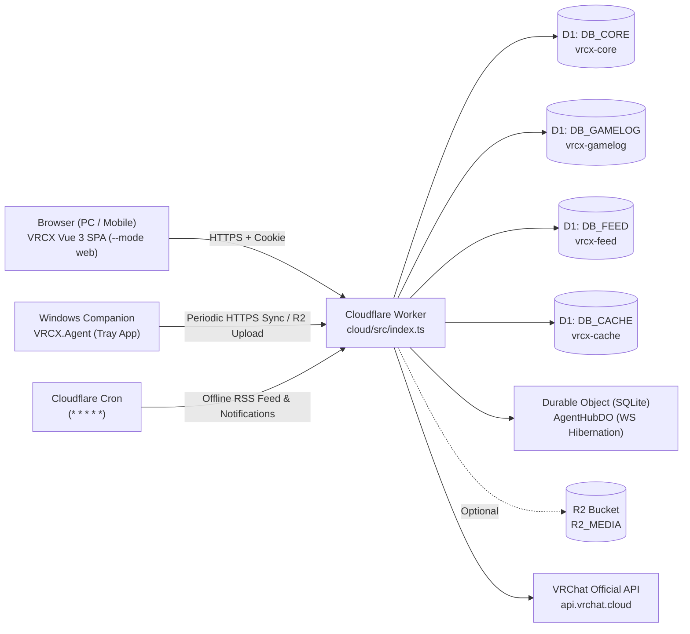

<div align="center">

#  VRCX-Worker

**Pure Stateless Cloud-Hosted Edition of VRCX on Cloudflare Workers (Free Tier)**

*Derived from upstream [vrcx-team/VRCX](https://github.com/vrcx-team/VRCX) (MIT License)*

**English** | [简体中文](./README.zh-CN.md) | [日本語](./README.ja.md)

[](https://deploy.workers.cloudflare.com/?url=https://github.com/nuomew/VRCX-Worker)
[](https://github.com/nuomew/VRCX-Worker/releases/latest)
[](https://github.com/nuomew/VRCX-Worker)
[](./LICENSE)

</div>

---

## Overview

**VRCX-Worker** is a cloud-native derivative of [vrcx-team/VRCX](https://github.com/vrcx-team/VRCX) (baseline `2026.11.14`) designed for **personal, single-user, 24/7 cloud hosting** on **Cloudflare Workers Free Tier**. It pairs the full VRCX Vue 3 web interface with a sharded Cloudflare D1 + Durable Object + optional R2 backend and an optional lightweight Windows system-tray companion ([`VRCX-Agent/`](./VRCX-Agent/)).

- **100% Stateless Browser Client**: No primary data is stored in browser OPFS or IndexedDB. Clearing browser cookies/cache, using incognito mode, or switching between PC and mobile browsers restores all settings, notes, memos, favorites, friend history, game logs, notifications, and encrypted VRChat sessions directly from Cloudflare D1.
- **24/7 Pure RSS Cron Aggregation & Sharded D1**: A 1-minute Cloudflare Cron trigger (`* * * * *`) obeys your configured Web/Cloud sync interval (default `300s` / 5 minutes) to record friend Online/Offline/GPS/Status/Bio feeds, Friend Log changes, and v1/v2 notifications even while every browser tab is closed—while prewarming a dedicated `DB_CACHE` shard (`vrcx-cache`) to prevent browser-side `api.vrchat.cloud` request storms.
- **Lightweight Windows Companion ([`VRCX-Agent/`](./VRCX-Agent/), Zero CEF / Zero Electron)**:
  - Runs quietly in the Windows system tray (~1.5 MB portable or single-file installer with bundled .NET 10 runtime, per-user `%LocalAppData%\Programs\VRCX.Agent`, zero UAC elevation).
  - Auto-adapts UI language to Simplified Chinese / English and includes **built-in GitHub Releases online auto-update with mandatory SHA-256 verification**.
  - Strictly follows the Web-configured Agent sync interval (default `60s`, range `30–3600s`) via periodic HTTPS `POST /api/agent/sync` with durable offline JSONL queuing and incremental `output_log_*.txt` byte-offset cursors + historical log backfill.
  - Built-in **Overseas (Direct)** vs **Mainland China (Proxy)** one-click network mode supporting Windows system proxy, HTTP/HTTPS/SOCKS4/SOCKS5, and native **VMess AEAD (`vmess://`)** links (TCP / TCP+HTTP obfs / TLS / WS / WSS).
  - Live current-instance PlayerList snapshots, real OS process start timestamps for VRChat & SteamVR, local PNG metadata embedding (`desktop/Dotnet/ScreenshotMetadata/`), optional R2 Cloud Gallery screenshot upload (original PNG or ≤1600px WebP), Discord Rich Presence, AutoAppLaunch, XSOverlay / OVRToolkit VR notifications, and 6 allowlisted remote commands.
- **Clean Repository Isolation & Zero Desktop Regression**: All upstream desktop-only VRCX code (Windows CEF, Linux/macOS Electron, NSIS installer, desktop build scripts) is isolated under [`desktop/`](./desktop/), while all secondary-development code (`wrangler.jsonc`, `cloud/`, `VRCX-Agent/`, `src/` Web adapters, `docs/`) lives cleanly at repository root without affecting Cloudflare automatic deployment.

---

## Architecture



### Cloudflare Free-Tier Design Highlights

| Component | Binding / Resource | Purpose & Quota Protection |
|---|---|---|
| **Static Assets** | `./build/web` | Compiled Vue SPA served from Cloudflare Edge at zero Worker invocation cost (`run_worker_first` only intercepts `/health`, `/poc/*`, `/api/*`, `/ws/*`) |
| **Core DB Shard** | `DB_CORE` (`vrcx-core`) | Config bundles, stats counters, `entity_users`/`entity_worlds` FTS5 (`trigram`) dictionaries, memos, favorites, avatar tags, Friend Log, notifications, devices, commands, AES-256-GCM encrypted cookie vault |
| **GameLog Shard** | `DB_GAMELOG` (`vrcx-gamelog`) | `gamelog_location`, `gamelog_join_leave`, `gamelog_portal_spawn`, `gamelog_video_play`, `gamelog_event`, `gamelog_external` with selective B-tree indexes & `UNIQUE` dedup keys |
| **Feed Shard** | `DB_FEED` (`vrcx-feed`) | `feed_gps`, `feed_online_offline`, `feed_status`, `feed_bio`, `activity_sessions_v2` |
| **Cache Shard** | `DB_CACHE` (`vrcx-cache`) | Shared server-side tiered VRChat API response cache (`vrc_api_cache`) & RSS snapshots, keeping browser refreshes off `api.vrchat.cloud` |
| **Durable Object** | `AGENT_HUB` (`AgentHubDO`) | SQLite-backed WebSocket Hibernation (`ctx.acceptWebSocket` + auto `ping`/`pong`) for optional live relay & instant command dispatch |
| **Object Storage** | `R2_MEDIA` *(optional)* | Private R2 bucket storing uploaded original PNG or compressed ≤1600px WebP screenshots for Cloud Gallery |

---

## Quick Start: One-Click Cloudflare Deployment

> Detailed step-by-step instructions, security secrets, R2 Cloud Gallery binding, and Windows Agent setup are available in:
> - **English**: [`docs/cloud-architecture/DEPLOY.md`](./docs/cloud-architecture/DEPLOY.md)
> - **简体中文**: [`docs/cloud-architecture/DEPLOY.zh-CN.md`](./docs/cloud-architecture/DEPLOY.zh-CN.md)
> - **日本語**: [`docs/cloud-architecture/DEPLOY.ja.md`](./docs/cloud-architecture/DEPLOY.ja.md)

1. Click **Deploy to Cloudflare** above, or open **Cloudflare Dashboard → Workers & Pages → Create → Import a repository** and select **`nuomew/VRCX-Worker`**.
2. Keep the repository root (`.`) and default deploy command `npx wrangler deploy`:
   - Root [`wrangler.jsonc`](./wrangler.jsonc) defines `"build": { "command": "npm run build:web" }`, so the Web SPA builds into `./build/web` automatically even if the Dashboard **Build command** is left blank.
   - Cloudflare Automatic Resource Provisioning creates all 4 D1 shards (`vrcx-core`, `vrcx-gamelog`, `vrcx-feed`, `vrcx-cache`) and `AgentHubDO` automatically (`R2_MEDIA` is disabled by default so deploys succeed without an R2 subscription; bind it manually or uncomment `r2_buckets` in `wrangler.jsonc` if you need Cloud Gallery).
   - On the first HTTP request, [`cloud/src/db/schemaBootstrap.ts`](./cloud/src/db/schemaBootstrap.ts) initializes all tables, indexes, and FTS5 dictionaries idempotently.
3. **Recommended Security Setup**: Before daily use, configure access protection and encryption secrets (`ADMIN_PASSCODE`, optional `ADMIN_TOTP_SECRET`, `COOKIE_MASTER_KEY`, or Cloudflare Access `CF_ACCESS_TEAM_DOMAIN` + `CF_ACCESS_AUD`) in **Worker → Settings → Variables and Secrets**.
4. *(Optional)* Download **`VRCX.Agent-v*-Setup-win-x64.exe`** from [GitHub Releases](https://github.com/nuomew/VRCX-Worker/releases/latest), open **Cloud Hub → Win Agent (HTTP Sync)** in the web UI, generate a Sync Secret, paste your Cloud URL and Sync Secret into `VRCX.Agent`, and click **Test & Save**.

---

## Key Features Comparison

| Capability | Cloud Web UI (`--mode web`) | Windows Companion (`VRCX.Agent`) |
|---|---|---|
| Friends, Worlds, Avatars, Groups, Moderation, Favorites, Memos, Charts | Built-in (stateless via D1) | — |
| 24/7 Offline Friend Feed, Friend Log & Notifications | Built-in (Cloudflare Cron RSS) | — |
| VRChat Local `output_log_*.txt` Tailing & Historical Backfill | Displays synced GameLog & Activity | Collects incrementally with offline JSONL queue |
| Live Current Instance PlayerList & Real Game/SteamVR Uptime | Real-time display | Captures OS process start times & live room players |
| VRChat Screenshot Gallery (PNG Metadata + Optional R2 WebP) | Cloud Gallery viewer & download | Embeds VRCX PNG metadata & uploads to R2 |
| Discord Rich Presence, AutoAppLaunch, XSOverlay / OVRToolkit | Remote control via Cloud Hub | Local Windows execution (6 allowlisted actions) |
| Mainland China Proxy & Native `vmess://` Support | Served via Cloudflare Edge | One-click Direct / Proxy toggle (HTTP/SOCKS/VMess) |

---

## Repository Structure

```text
VRCX-Worker/
├── wrangler.jsonc              # Root Cloudflare Workers auto-deploy config (Worker + Assets + 4 D1 + DO + R2 + Cron)
├── package.json                # Root Vite/Vitest scripts (`npm run build:web` invoked automatically by wrangler)
├── src/                        # Shared Vue 3 frontend + guarded WEB adapters:
│   ├── ipc-web/                #   Browser native-bridge replacements (WebApi, AppApi, bootstrap cache, RSS sync)
│   ├── services/database/cloud/#   Structured cloud repositories backed by Worker APIs (zero raw SQL over HTTP)
│   └── components/cloud/       #   Cloud Gate unlock screen, Cloud Hub, device & sync secret management
├── cloud/                      # Cloudflare Worker TypeScript backend
│   ├── src/                    #   auth/, cache/, crypto/, db/, hub/AgentHubDO.ts, routes/, search/, sync/
│   ├── migrations/             #   SQL DDL for core, gamelog, feed, and cache D1 shards
│   └── test/                   #   Miniflare / workerd automated Vitest test suites
├── VRCX-Agent/                 # Lightweight .NET 10 Windows tray companion (Core/, Platform/, Installer/)
├── VRCX-Agent.Tests/           # Cross-platform xUnit test suite for VRCX.Agent
├── docs/cloud-architecture/    # Multilingual DEPLOY guides & Tech-Spec.md
├── desktop/                    # Isolated original upstream desktop VRCX code (zero regression):
│   ├── Dotnet/                 #   Windows CEF, Linux/macOS Electron .NET backend, DBMerger, shared Discord/PNG libs
│   ├── src-electron/           #   Electron main process, preload scripts, Linux OpenVR binary
│   ├── Installer/              #   Windows NSIS desktop installer scripts & plugins
│   ├── build-scripts/          #   Desktop build, license generation, and packaging scripts
│   ├── VRCX.slnx               #   Desktop .NET solution file
│   ├── electron-builder.config.js
│   └── README/                 #   Original upstream desktop multilingual READMEs
├── images/                     # Application icons shared across Web, Agent, and Desktop
├── README.md                   # English documentation (this file)
├── README.zh-CN.md             # Simplified Chinese documentation
├── README.ja.md                # Japanese documentation
└── MEMORY.md                   # Engineering decision log and audit history
```

---

## Local Development & Verification

### Prerequisites
- **Node.js** `>= 24.15.0` (or pass `--engine-strict=false` if testing locally on Node 22) & **npm**
- **.NET 10 SDK** (for building/testing `VRCX-Agent` or `desktop/Dotnet/`)
- **Wrangler CLI** (installed under `cloud/node_modules/.bin/wrangler`)

### Commands

```bash
# 1. Frontend Web SPA build (outputs ./build/web) & unit tests
npm ci
npm run build:web
npm run test

# 2. Cloudflare Worker backend typecheck, workerd tests & deploy dry-run
npm --prefix cloud ci
npm --prefix cloud run typecheck
npm --prefix cloud test
./cloud/node_modules/.bin/wrangler deploy --dry-run

# 3. Windows Companion Agent build & cross-platform xUnit tests (.NET 10 SDK)
dotnet build VRCX-Agent/VRCX-Agent.csproj -c Release -r win-x64
dotnet test VRCX-Agent.Tests/VRCX-Agent.Tests.csproj -c Release

# 4. Upstream Desktop zero-regression checks (under desktop/)
npm run prod
dotnet build desktop/Dotnet/VRCX-Electron.csproj -c Release -p:Platform=x64 -r linux-x64
```

### Local Development Server

```bash
# Terminal 1: Start local Cloudflare Worker backend on http://127.0.0.1:8787
npm --prefix cloud run dev

# Terminal 2: Start Vite Web SPA dev server on http://127.0.0.1:9000 (proxies /api, /ws, /health)
npm run dev:web
```

---

## Documentation Index

| Document | English | 简体中文 | 日本語 |
|---|---|---|---|
| **Project Overview** | [`README.md`](./README.md) | [`README.zh-CN.md`](./README.zh-CN.md) | [`README.ja.md`](./README.ja.md) |
| **Deployment & Windows Agent Guide** | [`DEPLOY.md`](./docs/cloud-architecture/DEPLOY.md) | [`DEPLOY.zh-CN.md`](./docs/cloud-architecture/DEPLOY.zh-CN.md) | [`DEPLOY.ja.md`](./docs/cloud-architecture/DEPLOY.ja.md) |
| **Architecture Technical Spec** | [`Tech-Spec.md`](./docs/cloud-architecture/Tech-Spec.md) | — | — |
| **Upstream Desktop READMEs** | [`desktop/README/`](./desktop/README/) | [`desktop/README/README.zh_CN.md`](./desktop/README/README.zh_CN.md) | [`desktop/README/README.jp.md`](./desktop/README/README.jp.md) |

---

## Upstream Attribution & VRChat TOS Notice

- **Upstream Project**: Derived from **[vrcx-team/VRCX](https://github.com/vrcx-team/VRCX)** (`© 2019–2026 pypy, Natsumi, Map1en & VRCX Contributors`), distributed under the [MIT License](./LICENSE).
- **VRChat TOS**: Like upstream VRCX, VRCX-Worker is an external companion tool interacting exclusively with official VRChat APIs and local game logs. It does not modify the VRChat client.
- VRCX-Worker is not endorsed by VRChat and does not reflect the views or opinions of VRChat Inc. VRChat and all associated properties are trademarks or registered trademarks of VRChat Inc.
