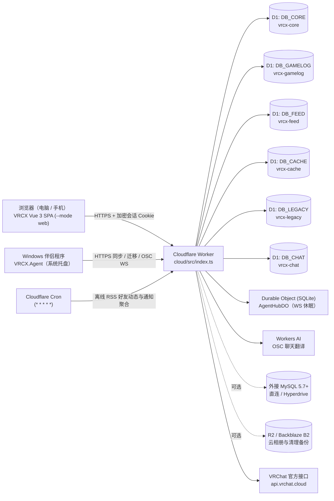

<div align="center">

#  VRCX-Worker

**基于 Cloudflare Workers 免费版的纯无状态云端 VRCX 个人托管版本**

*基于上游开源项目 [vrcx-team/VRCX](https://github.com/vrcx-team/VRCX)（MIT 许可证）二次开发*

[English](./README.md) | **简体中文** | [日本語](./README.ja.md)

[](https://deploy.workers.cloudflare.com/?url=https://github.com/nuomew/VRCX-Worker)
[](https://github.com/nuomew/VRCX-Worker/releases/latest)
[](https://github.com/nuomew/VRCX-Worker)
[](./LICENSE)

</div>

---

## 项目简介

**VRCX-Worker** 是基于 [vrcx-team/VRCX](https://github.com/vrcx-team/VRCX)（上游基线 `2026.11.14`）二次开发的**云端个人托管版 VRCX**，专为 **Cloudflare Workers 免费套餐** 深度优化。它将完整的 VRCX Vue 3 界面改造为 100% 无状态 Web 应用，由 **Cloudflare Workers + 6 分片 D1 数据库 + SQLite Durable Object（WebSocket 休眠）+ Workers AI + 可选外接 MySQL 5.7+ / MariaDB + 可选 R2 / Backblaze B2 私有相册** 驱动，并配套可选的轻量级 Windows 系统托盘伴侣程序（[`VRCX-Agent/`](./VRCX-Agent/)）。

- **100% 无状态浏览器体验（零本地存储依赖）**：不使用浏览器 OPFS 或 IndexedDB 存放主数据。清空缓存、使用无痕模式，或在电脑与手机浏览器之间随时切换，所有配置、好友备注、世界/模型收藏、历史记录、通知与加密存储的 VRChat 会话均可直接从云端完整恢复。
- **24/7 纯云端 RSS 定时聚合、6 分片紧凑压缩 D1 与可选外接 MySQL 5.7+**：
  - 内置每分钟触发的 Cloudflare Cron（`* * * * *`），严格遵循网页端配置的云端同步间隔（默认 `300s` / 5 分钟），即使关闭所有网页也能全天候记录好友上线/离线/GPS/状态/简介动态（内置双端 GPS 抖动静默防护）、好友变动日志（Friend Log）以及 v1/v2 通知，同时预热独立 `DB_CACHE`（`vrcx-cache`）分片，消除浏览器端对 `api.vrchat.cloud` 的请求风暴。
  - 全 6 个 D1 分片高频表均采用**透明 gzip 压缩 ≤1,000 行紧凑归档块**，显著降低单库体积与每日写入配额消耗。
  - 支持可选**外接 MySQL 5.7+ / MariaDB**（零依赖直连客户端或 Hyperdrive），提供「仅新写入外接」与「全量迁出 D1」双模式，并在存储写满或外接库故障时**自动降级为只读基础模式**保障访问不中断。
- **双二次元官网独立主题与 Web 体验深度增强**：
  - 内置两套独立布局壳体的二次元手游官网风格主题——**高定画册（`Lookbook`）**与**晴空档案（`Azure Archive`）**，对原 4 套内置主题（跟随系统 / 浅色 / 深色 / 午夜）100% 零影响。
  - 支持 **8 色全屏背景颜色切换**（Web 构建为 CSS 与语言包自动附加内容哈希防缓存）、**50%–100% 全局最高层级主题亮度调节**（覆盖下拉菜单/弹窗/Toast，并内置 `index.html` 首屏零闪白恢复）、均匀分布且零半字裁切的自适应顶栏，以及高定画册左侧直接复用原生完整分类好友列表（`FriendsSidebar`）与虚拟滚轮。
  - 新增**好友位置一排 4 卡扁平网格与半透明世界封面背景**、4 大历史记录表**按有数据日期/月份快速跳转**、**公开模型搜索**（`#/tools/avatar-search`）、社交**黑名单独立视图**、基于 Cloudflare Workers AI 的 **VRChat OSC 实时聊天翻译器**（含免费 Neurons 配额可视化），以及网页端互斥的**静态口令 / RFC-6238 TOTP 2FA**（30 天可信设备 Cookie）门禁保护。
- **桌面历史数据一键迁移、SQLite 导出与轻量级 Windows 伴侣（[`VRCX-Agent/`](./VRCX-Agent/)，零 CEF / 零 Electron）**：
  - 常驻 Windows 系统托盘，极低内存占用；提供标准安装版（内置 .NET 10 运行时，安装至 `%LocalAppData%\Programs\VRCX.Agent`，零管理员权限）、绿色版与约 1.5 MB 轻量版；内置 **GitHub Releases 在线自动更新（10 分钟 ETag 检查 + 强制 SHA-256 校验）**。
  - 支持云端编排的**多线程桌面 VRCX 历史数据迁移**（表级断点续传、拆半/重试去重与分类对账一键修复）及直接导出标准 **`VRCX.sqlite3`** 文件。
  - 严格按网页端配置的伴侣同步间隔（默认 `60s`，支持 `30–3600s`）通过 HTTPS `POST /api/agent/sync` 上传数据，内置断网持久化 JSONL 队列、增量 `output_log_*.txt` 字节偏移游标、历史日志回填，以及独立的 `/ws/chat-agent` OSC 实时翻译通道。
  - 内置 **海外直连 / 中国大陆代理** 一键切换，支持 Windows 系统代理、HTTP/HTTPS/SOCKS4/SOCKS5 以及**原生 `vmess://` 节点链接**（TCP / TCP+HTTP 伪装 / TLS / WS / WSS）。
  - 支持当前房间实时玩家列表快照、VRChat / SteamVR 真实系统进程启动时间、本地 PNG 元数据写入（复用 `desktop/Dotnet/ScreenshotMetadata/`）、可选 **R2 / Backblaze B2** 云相册上传（原图 PNG 或 ≤1600px WebP 压缩）、Discord 富状态（RPC）、AutoAppLaunch、XSOverlay / OVRToolkit VR 通知及 6 项白名单远程指令。
- **清晰目录隔离与原版桌面端零退化**：原版桌面端 VRCX 专属代码（Windows CEF、Linux/macOS Electron、NSIS 安装包、桌面构建脚本）已完整收纳进独立目录 [`desktop/`](./desktop/)；二次开发核心（`wrangler.jsonc`、`cloud/`、`VRCX-Agent/`、`src/` 云端适配层、`docs/`）全部位于仓库根目录，对 Cloudflare 自动部署零影响。

---

## 系统架构



### Cloudflare 免费额度工程化设计

| 组件 | 绑定名 / 资源 | 职责与免费额度保护机制 |
|---|---|---|
| **静态前端资源** | `./build/web` | 编译后的 Vue SPA 直接由 Cloudflare 边缘节点分发，零 Worker 请求消耗（`run_worker_first` 仅拦截 `/health`、`/poc/*`、`/api/*`、`/ws/*`）；CSS 与多语言包带内容哈希防旧缓存 |
| **核心分片** | `DB_CORE`（`vrcx-core`） | 配置包、统计计数器、`entity_users`/`entity_worlds` FTS5（`trigram`）搜索字典、备注、收藏、模型标签、紧凑压缩 Friend Log 与通知、设备与指令表、AES-256-GCM 加密 Cookie 保险库 |
| **游戏日志分片** | `DB_GAMELOG`（`vrcx-gamelog`） | 透明 gzip 紧凑归档块（`gamelog_archive_chunks`）与用户/世界汇总表，涵盖房间、玩家进出、传送门、视频、事件与外部日志 |
| **动态流分片** | `DB_FEED`（`vrcx-feed`） | 透明 gzip 紧凑归档块（`feed_archive_chunks`：GPS、上下线、状态、简介）及 `activity_sessions_v2` 活跃度会话表 |
| **缓存分片** | `DB_CACHE`（`vrcx-cache`） | 服务端共享分级缓存（`vrc_api_cache`）与 RSS 快照，大幅降低 `api.vrchat.cloud` 重复请求与限流风险 |
| **历史迁移分片** | `DB_LEGACY`（`vrcx-legacy`） | 独立承载桌面 VRCX 历史数据归档块、历史汇总、桌面配置及迁移断点/状态控制表 |
| **聊天翻译分片** | `DB_CHAT`（`vrcx-chat`） | 独立存放 VRChat OSC 聊天翻译历史、翻译预设与 Workers AI Neurons 每日用量统计 |
| **云端 AI** | `AI` | 内置 Cloudflare Workers AI 绑定（免费套餐每日 `10,000` Neurons），驱动 VRChat OSC 实时双向翻译 |
| **持久化对象** | `AGENT_HUB`（`AgentHubDO`） | SQLite WebSocket Hibernation（`ctx.acceptWebSocket` + 零计费 `ping`/`pong`），负责实时中继、远程指令与独立 `/ws/chat-agent` 通道 |
| **外接库与对象存储** | `外接 MySQL 5.7+`、`R2_MEDIA` / `Backblaze B2` *(可选)* | 支持将大体积业务与归档表分流/迁出至外接 MySQL 5.7+，并在私有 R2 或 B2 存放云相册照片与数据库清理备份 |

---

## 快速开始：一键部署到 Cloudflare Workers

> 完整保姆级部署教程、全部安全环境变量说明、R2 云相册绑定与 Windows 伴侣配置请查阅：
> - **简体中文**：[`docs/cloud-architecture/DEPLOY.zh-CN.md`](./docs/cloud-architecture/DEPLOY.zh-CN.md)
> - **English**：[`docs/cloud-architecture/DEPLOY.md`](./docs/cloud-architecture/DEPLOY.md)
> - **日本語**：[`docs/cloud-architecture/DEPLOY.ja.md`](./docs/cloud-architecture/DEPLOY.ja.md)

1. 点击页面顶部的 **Deploy to Cloudflare** 按钮，或在 **Cloudflare 控制台 → Workers & Pages → 创建 → 导入仓库** 中选择 **`nuomew/VRCX-Worker`**。
2. 保持默认根目录（`.`）与默认部署命令 `npx wrangler deploy`：
   - 根目录 [`wrangler.jsonc`](./wrangler.jsonc) 已内置 `"build": { "command": "npm run build:web" }`，即使控制台的 **构建命令** 留空，部署时也会自动编译完整的 Web SPA 至 `./build/web`。
   - Cloudflare 自动资源编排会在首次部署时自动创建 **6 个 D1 分片**（`vrcx-core`、`vrcx-gamelog`、`vrcx-feed`、`vrcx-cache`、`vrcx-legacy`、`vrcx-chat`）、`AgentHubDO` 与 `AI` 绑定（`R2_MEDIA` 默认留空以确保未开通 R2 时可零失败一键部署；`keep_vars` 与 `unsafe.metadata.keep_bindings` 会在每次 Git 自动部署时自动保留控制台内手动绑定的机密、环境变量与 R2 存储桶）。
   - 首次收到 HTTP 请求时，[`cloud/src/db/schemaBootstrap.ts`](./cloud/src/db/schemaBootstrap.ts) 会幂等初始化全部数据表、索引与 FTS5 搜索字典，无需手动执行迁移命令。
3. **强烈建议配置访问保护与加密密钥**：在 **Worker → 设置 → 变量和机密（Variables and Secrets）** 中配置 `ADMIN_PASSCODE`（访问口令）、可选 `ADMIN_TOTP_SECRET`（两步验证）、`COOKIE_MASTER_KEY`（32 位以上主加密密钥）或 Cloudflare Access（`CF_ACCESS_TEAM_DOMAIN` + `CF_ACCESS_AUD`），也可直接在网页 **设置 → 安全** 中启用互斥的静态口令或 TOTP 2FA 门禁。
4. *(可选)* 前往 [GitHub Releases](https://github.com/nuomew/VRCX-Worker/releases/latest) 下载 **`VRCX.Agent-v*-Setup-win-x64.exe`** 安装；在网页底部状态栏点 **云端 → 云端中心 → Windows 伴侣（HTTP 同步）** 复制云端地址并创建同步密钥，粘贴到 `VRCX.Agent` 设置窗口中点击 **测试连接并保存** 即可后台运行。

---

## 功能分布一览

| 功能模块 | 云端网页端（`--mode web`） | Windows 伴侣（`VRCX.Agent`） |
|---|---|---|
| 好友/世界/模型/群组/黑名单管理、收藏、备注、统计图表 | 原生内置（D1 / 外接 MySQL 无状态持久化） | — |
| 双二次元官网独立主题（高定画册 & 晴空档案）+ 8 色全屏背景 + 主题亮度 | 8 色整页背景切换、全局顶层压暗与首屏零闪白恢复 | — |
| 历史日期/月份快速导航 & 公开模型搜索 | 4 大历史表按有数据日期跳转；内置公开模型搜索工具 | — |
| 24/7 离线好友动态（Feed）、好友变动日志与通知 | 原生内置（Cloudflare Cron RSS + 双端 GPS 抖动防护） | — |
| 桌面 VRCX 历史数据一键迁移 & 标准 `VRCX.sqlite3` 导出 | 云端任务控制、分类对账与一键修复 | 多线程表级断点上传、拆半去重与直接导出 `.sqlite3` |
| VRChat OSC 实时聊天翻译器 | Workers AI 双向翻译、每日免费 Neurons 配额环与记录 | 独立 `/ws/chat-agent` 实时桥接本地 VRChat OSC |
| 外接 MySQL 5.7+ 与 R2 / Backblaze B2 云存储 | 混合/全量迁出 MySQL、B2/R2 云相册、满容/断联自动只读降级 | 写入 VRCX PNG 元数据并上传至 R2 / B2 |
| VRChat 本地 `output_log_*.txt` 增量采集与实时玩家/时长 | 展示完整 GameLog、当前房间玩家与真实运行时长 | 增量读取、断网 JSONL 补传与 OS 真实进程启动时间 |
| Discord 富状态、AutoAppLaunch、XSOverlay / OVRToolkit | 网页端下发远程指令 | 本地 Windows 执行（仅允许 6 项白名单动作） |
| 海外直连 / 中国大陆代理与原生 `vmess://` | 经 Cloudflare 全球边缘节点访问 | 托盘/设置一键切换（系统代理/HTTP/SOCKS/VMess） |

---

## 仓库目录结构

```text
VRCX-Worker/
├── wrangler.jsonc              # 根目录 Cloudflare Workers 自动部署配置（Worker + 静态资源 + 6 D1 + DO + AI + Cron）
├── package.json                # 根目录 Vite/Vitest 脚本（wrangler 自动调用 npm run build:web）
├── src/                        # 共享 Vue 3 前端源码 + WEB 守卫云端适配层与双官网主题：
│   ├── views/Layout/           #   MainLayout + 高定画册/晴空档案独立壳体 + 顶栏自适应与主题亮度模块
│   ├── styles/themes/          #   严格作用域隔离的 lookbook.css 与 archive.css（含 8 色全屏背景）
│   ├── ipc-web/                #   浏览器端原生桥替代（WebApi、AppApi、启动缓存、RSS 同步）
│   ├── services/database/cloud/#   结构化云端仓储层（零明文 SQL 暴露）
│   └── components/cloud/       #   云端门禁、云端中心、外接 MySQL / B2 存储、桌面迁移与 2FA 管理界面
├── cloud/                      # Cloudflare Worker TypeScript 后端
│   ├── src/                    #   auth/、cache/、crypto/、db/（compactArchive、externalMysql*）、hub/、routes/、search/、storage/、sync/
│   ├── migrations/             #   core、gamelog、feed、cache、legacy、chat 六个 D1 分片的 SQL DDL
│   └── test/                   #   基于 Miniflare / workerd 的 Vitest 自动化测试套件
├── VRCX-Agent/                 # 轻量级 .NET 10 Windows 托盘伴侣源码与 Inno Setup 安装脚本
├── VRCX-Agent.Tests/           # VRCX.Agent 跨平台 xUnit 单元测试
├── docs/cloud-architecture/    # 多语言部署手册（DEPLOY*.md）与技术规格文档（Tech-Spec.md）
├── desktop/                    # 独立隔离的原版桌面端 VRCX 代码（保持零退化）：
│   ├── Dotnet/                 #   Windows CEF、Linux/macOS Electron .NET 后端、DBMerger 及共享 Discord/PNG 模块
│   ├── src-electron/           #   Electron 主进程、preload 与 Linux OpenVR 动态库
│   ├── Installer/              #   原版 Windows NSIS 安装包脚本与插件
│   ├── build-scripts/          #   桌面端构建、第三方许可生成与打包脚本
│   ├── VRCX.slnx               #   原版桌面端 .NET 解决方案
│   ├── electron-builder.config.js
│   └── README/                 #   原版桌面端多语言 README 存档
├── images/                     # 网页端、伴侣程序与桌面端共用图标
├── README.md                   # 英文说明文档
├── README.zh-CN.md             # 简体中文说明文档（本文档）
├── README.ja.md                # 日语说明文档
└── MEMORY.md                   # 架构决策、审计修复记录与运维备忘
```

---

## 本地开发与验证

### 环境要求
- **Node.js** `>= 24.15.0`（如本机使用 Node 22，安装依赖时可加 `--engine-strict=false`）与 **npm**
- **.NET 10 SDK**（编译/测试 `VRCX-Agent` 或 `desktop/Dotnet/`）
- **Wrangler CLI**（位于 `cloud/node_modules/.bin/wrangler`）

### 常用构建与验证命令

```bash
# 1. 编译云端 Web SPA（输出至 ./build/web）并运行前端单元测试
npm ci
npm run build:web
npm run test

# 2. 云端 Worker 类型检查、workerd 测试与部署预演
npm --prefix cloud ci
npm --prefix cloud run typecheck
npm --prefix cloud test
./cloud/node_modules/.bin/wrangler deploy --dry-run

# 3. Windows 伴侣 VRCX.Agent 编译与跨平台 xUnit 测试（需 .NET 10 SDK）
dotnet build VRCX-Agent/VRCX-Agent.csproj -c Release -r win-x64
dotnet test VRCX-Agent.Tests/VRCX-Agent.Tests.csproj -c Release

# 4. 原版桌面端零退化回归验证（位于 desktop/）
npm run prod
dotnet build desktop/Dotnet/VRCX-Electron.csproj -c Release -p:Platform=x64 -r linux-x64
```

### 本地联调开发

```bash
# 终端 1：启动本地 Cloudflare Worker 后端（http://127.0.0.1:8787）
npm --prefix cloud run dev

# 终端 2：启动 Vite Web 开发服务器（http://127.0.0.1:9000，自动代理 /api、/ws、/health）
npm run dev:web
```

---

## 文档导航

| 文档 | English | 简体中文 | 日本語 |
|---|---|---|---|
| **项目总览** | [`README.md`](./README.md) | [`README.zh-CN.md`](./README.zh-CN.md) | [`README.ja.md`](./README.ja.md) |
| **部署与 Windows 伴侣指南** | [`DEPLOY.md`](./docs/cloud-architecture/DEPLOY.md) | [`DEPLOY.zh-CN.md`](./docs/cloud-architecture/DEPLOY.zh-CN.md) | [`DEPLOY.ja.md`](./docs/cloud-architecture/DEPLOY.ja.md) |
| **架构技术规格书** | [`Tech-Spec.md`](./docs/cloud-architecture/Tech-Spec.md) | — | — |
| **原版桌面端说明文档** | [`desktop/README/`](./desktop/README/) | [`desktop/README/README.zh_CN.md`](./desktop/README/README.zh_CN.md) | [`desktop/README/README.jp.md`](./desktop/README/README.jp.md) |

---

## 上游致谢与 VRChat 服务条款声明

- **上游项目**：本项目衍生自 **[vrcx-team/VRCX](https://github.com/vrcx-team/VRCX)**（`© 2019–2026 pypy, Natsumi, Map1en & VRCX Contributors`），遵循 [MIT 许可证](./LICENSE) 开源。
- **VRChat 服务条款（TOS）**：与原版 VRCX 一致，VRCX-Worker 仅作为外部辅助工具访问 VRChat 官方 API 与本地游戏日志文件，不修改、不注入 VRChat 游戏客户端。
- 本项目未获 VRChat 官方认可，不代表 VRChat Inc. 的立场或观点；VRChat 及其相关标识均为 VRChat Inc. 的商标或注册商标。
